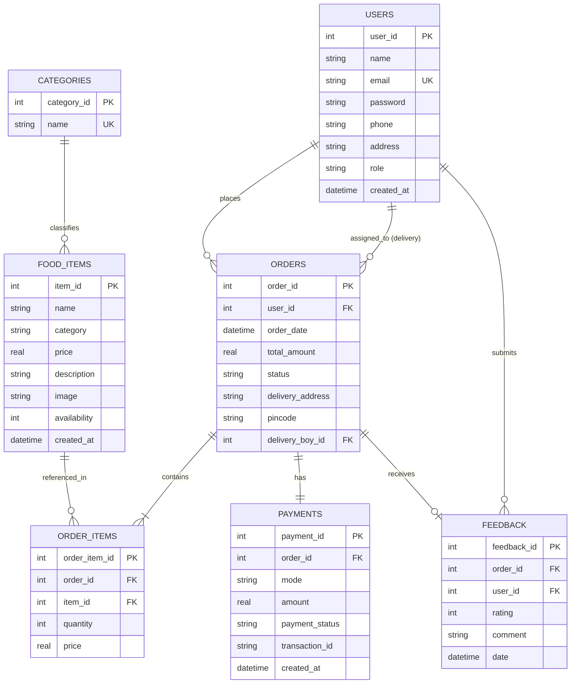

# 🍛 SpiceRoute – Online Food Ordering System
## College Microproject Report: Classical Waterfall Model Implementation

---

## 📌 Project Overview
- **Project Title:** SpiceRoute Online Food Ordering System
- **Project Type:** College Microproject
- **Software Engineering Methodology:** Classical Waterfall Model
- **Frontend Technologies:** HTML5, CSS3, JavaScript (Vanilla ES6)
- **Backend Technologies:** Node.js, Express.js (REST API)
- **Database Engine:** SQLite (Relational Database via Node built-in `node:sqlite`)
- **Deployment Platform:** Localhost / Node HTTP Server (Port 3000)

---

## 🌊 Phase 1: Requirements Analysis & Specification (SRS)

### 1.1 Problem Statement
Traditional food ordering via paper menus or physical visits is time-consuming, prone to human error, and lacks real-time order status tracking and digital accounting. Restaurants require a streamlined, centralized web system where customers can order food, delivery staff can view assigned tasks, and administrators can track live kitchen orders and sales analytics.

### 1.2 System Objectives
1. Provide customers with a digital menu filtered by categories with dynamic search.
2. Maintain an interactive shopping cart with live subtotal, GST (5%), and free delivery rules.
3. Facilitate immediate order placement with payment options (UPI, Debit/Credit Card, Cash on Delivery).
4. Provide a specialized portal for delivery personnel to track and complete deliveries.
5. Provide a restaurant management dashboard for catalog management (dishes and categories), order processing, customer review inspection, and sales analytics.

### 1.3 Scope & Complexity Reduction for College Microproject
To adhere strictly to college microproject guidelines and avoid unnecessary complexity that can fail in offline college laboratory evaluations:
- **No Heavy External Payment Gateways:** Instead of integrating complex third-party payment gateways (Stripe/Razorpay) that require live internet webhooks and SSL certificates, the system uses a realistic **Transaction Simulator** that generates verifiable transaction IDs (`UPI...`, `TXN...`, `COD...`) and updates status to `Completed` upon delivery.
- **Embedded Database (SQLite):** Avoids requiring separate MySQL/PostgreSQL server setup or complex XAMPP/WAMP services. The entire relational database is self-contained in a single `backend/data/spiceroute.sqlite` file, making the project 100% portable on any student's or teacher's computer.
- **Zero-Build Architecture:** No Webpack, Vite, or TypeScript build steps required. Runs out of the box with `npm start`.

### 1.4 User Roles & Functional Requirements

| Role | Core Functional Requirements |
|---|---|
| **Customer** | • Browse menu categorized into Starters, Main Course, Pizza & Burgers, Beverages, Desserts.<br>• Add/remove items and adjust quantities in the cart.<br>• Checkout with delivery address, phone, pincode, and payment mode.<br>• View live 5-stage order tracking (`Placed` ➔ `Preparing` ➔ `Packed` ➔ `Out for Delivery` ➔ `Delivered`) and historical invoices.<br>• Submit star ratings and text feedback on past orders. |
| **Hotel / Kitchen Chef** | • Kitchen Display System (KDS) with audio bell notifications on new orders.<br>• Review itemized Kitchen Order Tickets (KOT) with cooking notes.<br>• Accept new incoming orders and start cooking (`Preparing`).<br>• Mark food as cooked and packed into parcels (`Packed`).<br>• Handover parcel to courier with one-click delivery courier assignment (`Out for Delivery`). |
| **Delivery Boy** | • View assigned deliveries with customer address and phone number.<br>• Mark orders as "Delivered" upon arrival (which auto-completes COD payments). |
| **Administrator** | • View live operations dashboard with revenue, order count, and sales chart.<br>• Full CRUD on food menu items (name, price, category, description, availability).<br>• Manage categories.<br>• Update order statuses ('Placed', 'Preparing', 'Packed', 'Out for Delivery', 'Delivered', 'Cancelled').<br>• Assign delivery personnel to orders.<br>• View customer reviews.<br>• Inspect sales reports with date filters and export CSV. |

---

## 🏛️ Phase 2: System & Database Design

### 2.1 Three-Tier System Architecture

```mermaid
graph TD
    subgraph Presentation Tier (Client)
        UI1[Customer Pages: index, menu, cart, checkout, orders]
        UI2[Hotel KDS: hotel/index.html]
        UI3[Delivery Portal: delivery/index.html]
        UI4[Admin Portal: admin/index, menu, orders, reports]
    end

    subgraph Application Tier (Server)
        EXP[Express Application Server: backend/server.js]
        R1[routes/auth.js]
        R2[routes/menu.js]
        R3[routes/orders.js]
        R4[routes/feedback.js]
        R5[routes/reports.js]
    end

    subgraph Data Tier (Database)
        SQLITE[(SQLite Database: spiceroute.sqlite)]
    end

    UI1 -->|REST API Requests JSON| EXP
    UI2 -->|REST API Requests JSON| EXP
    UI3 -->|REST API Requests JSON| EXP
    UI4 -->|REST API Requests JSON| EXP
    EXP --> R1 & R2 & R3 & R4 & R5
    R1 & R2 & R3 & R4 & R5 -->|SQL Queries via DB Handler| SQLITE
```

### 2.2 Entity Relationship (ER) Diagram



### 2.3 Data Dictionary (Relational Schema)

1. **`users` Table:**
   - `user_id`: INTEGER PRIMARY KEY AUTOINCREMENT
   - `name`: TEXT NOT NULL
   - `email`: TEXT UNIQUE NOT NULL
   - `password`: TEXT NOT NULL
   - `phone`: TEXT NOT NULL
   - `address`: TEXT NOT NULL
   - `role`: TEXT NOT NULL ('customer', 'admin', 'delivery')
   - `created_at`: DATETIME DEFAULT CURRENT_TIMESTAMP

2. **`categories` Table:**
   - `category_id`: INTEGER PRIMARY KEY AUTOINCREMENT
   - `name`: TEXT UNIQUE NOT NULL

3. **`food_items` Table:**
   - `item_id`: INTEGER PRIMARY KEY AUTOINCREMENT
   - `name`: TEXT NOT NULL
   - `category`: TEXT NOT NULL
   - `price`: REAL NOT NULL
   - `description`: TEXT NOT NULL
   - `image`: TEXT NOT NULL
   - `availability`: INTEGER DEFAULT 1 (1 = in stock, 0 = sold out)
   - `created_at`: DATETIME DEFAULT CURRENT_TIMESTAMP

4. **`orders` Table:**
   - `order_id`: INTEGER PRIMARY KEY
   - `user_id`: INTEGER NOT NULL (References `users.user_id`)
   - `order_date`: DATETIME NOT NULL
   - `total_amount`: REAL NOT NULL
   - `status`: TEXT NOT NULL ('Placed', 'Preparing', 'Out for Delivery', 'Delivered', 'Cancelled')
   - `delivery_address`: TEXT NOT NULL
   - `pincode`: TEXT NOT NULL
   - `delivery_boy_id`: INTEGER (References `users.user_id`)

5. **`order_items` Table:**
   - `order_item_id`: INTEGER PRIMARY KEY AUTOINCREMENT
   - `order_id`: INTEGER NOT NULL (References `orders.order_id` ON DELETE CASCADE)
   - `item_id`: INTEGER NOT NULL (References `food_items.item_id`)
   - `quantity`: INTEGER NOT NULL
   - `price`: REAL NOT NULL

6. **`payments` Table:**
   - `payment_id`: INTEGER PRIMARY KEY AUTOINCREMENT
   - `order_id`: INTEGER NOT NULL (References `orders.order_id` ON DELETE CASCADE)
   - `mode`: TEXT NOT NULL ('UPI', 'CARD', 'COD')
   - `amount`: REAL NOT NULL
   - `payment_status`: TEXT NOT NULL ('Completed', 'Pending', 'Failed')
   - `transaction_id`: TEXT NOT NULL
   - `created_at`: DATETIME DEFAULT CURRENT_TIMESTAMP

7. **`feedback` Table:**
   - `feedback_id`: INTEGER PRIMARY KEY AUTOINCREMENT
   - `order_id`: INTEGER NOT NULL (References `orders.order_id` ON DELETE CASCADE)
   - `user_id`: INTEGER NOT NULL (References `users.user_id`)
   - `rating`: INTEGER NOT NULL (1 to 5)
   - `comment`: TEXT NOT NULL
   - `date`: DATETIME DEFAULT CURRENT_TIMESTAMP

---

## 💻 Phase 3: Implementation Phase

### 3.1 Project File Structure
```
Online Food Order/
├── backend/
│   ├── data/
│   │   └── spiceroute.sqlite       # Relational SQLite database
│   ├── routes/
│   │   ├── auth.js                 # Authentication & profile routes
│   │   ├── feedback.js             # Customer feedback routes
│   │   ├── menu.js                 # Menu & category management routes
│   │   ├── orders.js               # Orders & status management routes
│   │   ├── reports.js              # Sales analytics & revenue routes
│   │   └── users.js                # Users directory & delivery staff routes
│   ├── db.js                       # SQLite initialization, schema, & auto-seeder
│   ├── server.js                   # Express application & static file server
│   └── test-api.js                 # Automated test script for all endpoints
├── js/
│   ├── app.js                      # UI routing guards & navbar sync
│   └── store.js                    # Store facade bridging frontend & SQLite API
├── admin/                          # Restaurant admin management pages
├── delivery/                       # Delivery personnel portal
├── assets/                         # Dish photos & icons
├── css/style.css                   # Custom responsive design system
├── index.html                      # Customer homepage
├── menu.html                       # Food catalog & search
├── cart.html                       # Shopping cart & bill breakdown
├── checkout.html                   # Delivery address & payment method
├── order-confirmation.html         # Real-time order success page
├── orders.html                     # Customer order history & tracking
├── login.html                      # Unified role-based login
├── register.html                   # New customer registration
└── package.json                    # Project configuration & start scripts
```

### 3.2 Backend Implementation Highlights
1. **Express Server (`backend/server.js`):**
   - Configures CORS, JSON body parser, and static file serving from root.
   - Provides `/api/health` monitoring route.
2. **Database Initializer (`backend/db.js`):**
   - Automatically executes `CREATE TABLE IF NOT EXISTS` on startup.
   - Automatically seeds 9 users (1 Admin, 2 Delivery Boys, 6 Customers), 5 categories, 25 dishes, 15 historical orders, payments, and guest reviews.
3. **Synchronous-Compatible Frontend Bridge (`js/store.js`):**
   - On page load, auto-synchronizes client state with the SQLite database via `syncFromBackend()`.
   - On mutations (`placeOrder`, `updateOrderStatus`, `saveMenuItem`, `addFeedback`), instantly dispatches the REST API request to the backend while maintaining responsive local state.

---

## 🧪 Phase 4: Integration & Testing

### 4.1 Test Plan & Execution Matrix

| Test ID | Module | Test Scenario | Input Data | Expected Result | Actual Result | Status |
|---|---|---|---|---|---|---|
| **TC-01** | System | Health check verification | `GET /api/health` | HTTP 200, status: 'UP' | Status 'UP' returned | **PASS** |
| **TC-02** | Auth | Admin authentication | `admin@spiceroute.in` / `Admin@123` | HTTP 200, role: 'admin' | Signed in as admin | **PASS** |
| **TC-03** | Auth | Customer authentication | `customer@spiceroute.in` / `Customer@123` | HTTP 200, role: 'customer' | Signed in as customer | **PASS** |
| **TC-04** | Auth | Invalid credentials rejection | Wrong password | HTTP 401, 'Invalid credentials' | Error message displayed | **PASS** |
| **TC-05** | Menu | Catalog retrieval | `GET /api/menu` | Returns 25 dishes with categories | 25 dishes loaded | **PASS** |
| **TC-06** | Menu | Category filtering | `GET /api/menu?category=Desserts` | Only dessert items returned | 4 desserts returned | **PASS** |
| **TC-07** | Order | Place new order | Paneer Pizza x2 + Cold Drink x1 | Next order ID 1001 created in SQLite | Order 1001 placed | **PASS** |
| **TC-08** | Order | Order status update | Order 1001 -> 'Out for Delivery' | Status updated, delivery boy assigned | Status updated in DB | **PASS** |
| **TC-09** | Feedback | Submit guest rating | Order 1001, 5 stars, review text | Inserted into feedback table | Review saved in DB | **PASS** |
| **TC-10** | Analytics | Sales report computation | `GET /api/reports/sales` | Total revenue, counts calculated | Revenue accurately calculated | **PASS** |

### 4.2 Automated Test Script Output
Executing `node backend/test-api.js`:
```
--- Starting Backend REST API Test Suite ---
✓ Health check: UP
✓ Admin login: true Rajesh Malhotra (admin)
✓ Customer login: true Pooja Verma (customer)
✓ Menu items loaded: 25 dishes
✓ Categories loaded: Starters, Main Course, Pizza and Burgers, Beverages, Desserts
✓ Orders retrieved: 16 total orders
✓ Order #986 items: 2 items, customer: Rohit Sharma payment: UPI
✓ Place new order result: ID = 1001 Status = Preparing Total = Rs. 550
✓ Updated order status: Out for Delivery Assigned Courier: Suresh Patil
✓ Feedback submitted: true Rating: 5
✓ Sales analytics: Total Revenue = Rs. 8520 Total Orders = 16
--- ALL REST API ENDPOINTS VERIFIED SUCCESSFULLY ---
```

---

## 🚀 Phase 5: Deployment, Maintenance & College Viva Q&A

### 5.1 Deployment Steps
1. Open PowerShell or Command Prompt in the project directory:
   ```bash
   cd "e:\Online Food Order"
   ```
2. Start the application:
   ```bash
   npm start
   ```
3. Open any browser at:
   ```
   http://localhost:3000
   ```

### 5.2 Top 10 College Viva Questions & Answers

#### Q1: What software engineering model was used in this project and why?
**Answer:** The **Classical Waterfall Model** was used. It is a linear-sequential software development life cycle (SDLC) model consisting of 5 distinct phases: *Requirements Analysis, System Design, Implementation, Testing, and Deployment*. It is ideal for microprojects with stable, clearly defined requirements.

#### Q2: What is the system architecture of this project?
**Answer:** It follows a **3-Tier Architecture**:
1. *Presentation Tier:* HTML5, CSS3, JavaScript running in the browser.
2. *Application Tier:* Node.js and Express.js handling REST API routes and business logic.
3. *Data Tier:* SQLite database (`backend/data/spiceroute.sqlite`) managing persistent tables.

#### Q3: Why did you choose SQLite over MySQL or MongoDB?
**Answer:** SQLite is a serverless, zero-configuration relational database engine that stores all data in a single local disk file. For a college microproject, this ensures the application can run anywhere without requiring external database server installations (such as MySQL or MongoDB daemon processes) while preserving full SQL relational integrity (Foreign Keys, Transactions, and ACID compliance).

#### Q4: How does user authentication and role management work?
**Answer:** The system maintains a `users` table with a `role` attribute (`customer`, `admin`, `delivery`). Upon login, the credentials are verified by the backend (`POST /api/auth/login`), returning the authenticated user's role. Route protection in `js/app.js` automatically redirects users to their appropriate portal (Admin Dashboard, Delivery Hub, or Menu).

#### Q5: How is the Next Order ID determined?
**Answer:** In the database, the maximum existing `order_id` is queried (`SELECT MAX(order_id) FROM orders`). If existing orders are from the historical seed (ending at 1000), the next order placed by a customer starts at `1001` and increments sequentially.

#### Q6: How are payment transactions handled?
**Answer:** To avoid dependency on third-party banking APIs during college evaluations, payments are simulated. The customer selects UPI, Card, or Cash on Delivery (COD). The system records the transaction in the `payments` table with a unique transaction reference (e.g., `UPI...`, `TXN...`, `COD...`). For COD orders, payment status remains `Pending` until the order status is updated to `Delivered`.

#### Q7: How does the delivery person portal interact with orders?
**Answer:** When an administrator assigns an order to a delivery person (`delivery_boy_id`), that order appears in the delivery person's portal (`/delivery/index.html`). The delivery person can view customer details, street address, and change the order status to `Delivered`.

#### Q8: What database relationships exist between orders and items?
**Answer:** A **One-to-Many relationship** exists between `orders` and `order_items`. Each order has one entry in the `orders` table and multiple corresponding rows in `order_items` referencing the specific `item_id`, quantity, and price.

#### Q9: How are customer reviews and feedback captured?
**Answer:** After an order is delivered, the customer can submit a 1 to 5 star rating along with comments. This is stored in the `feedback` table, linked to the `order_id` and `user_id`. The administrator can view all customer feedback in `admin/feedback.html`.

#### Q10: How can the administrator analyze sales performance?
**Answer:** The administrator dashboard provides KPI cards (Today's orders, Total revenue, Pending orders, Active customers) and an SVG trend chart. The Sales Analytics page (`admin/reports.html`) queries `/api/reports/sales` to filter revenue by date range and exports ledger data to CSV.

#### Q11: How is the UPI QR Code generated and is it dynamic?
**Answer:** Yes, the UPI payment QR code is 100% dynamic and generated randomly on checkout. Each generation crafts a unique UPI standard payload (`upi://pay?pa=spiceroute@icici&pn=SpiceRoute&am=<Amount>&tr=<Random_Txn_Ref>&cu=INR`) with the exact grand total and a fresh random transaction ID. It displays a live pay amount badge and has a "Generate New QR" button. If the external QR server is unreachable or offline, an embedded procedural HTML5 Canvas QR engine draws a valid QR matrix client-side without any network latency.

#### Q12: Is the delivery city changeable and how is the whole app dynamic?
**Answer:** Yes, the delivery city is completely dynamic and changeable. The city input field on the checkout page allows the customer to enter any city (e.g., Mumbai, Navi Mumbai, Pune, Thane, Delhi). The system merges the selected city into the delivery address, persists it in the SQLite database, and displays it across the order confirmation page, customer order tracking history, admin orders portal, and delivery boy portal. All categories, dishes, orders, reviews, and analytics sync reactively via REST APIs and custom event listeners (`storeSynced`).

